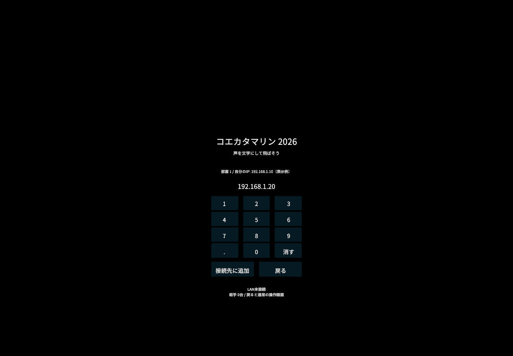

# 自動発見できないときのIP指定

0.5.0では、同じLANにある相手のIPv4アドレスを入力して接続できます。端末間のUDP通信自体が禁止されているWi-Fiでは使えません。NAT越え、クラウド中継、外部の接続サービスは追加していません。

## 操作

1. 両方のQuestを同じWi-Fiへ接続し、アプリで同じ部屋番号を選びます。
2. 両方で「接続 / 切断」を押します。相手が見つかればIP指定は不要です。
3. 相手側で「IPで接続」を開き、「自分のIP」を確認します。表示できない場合はQuestのWi-Fi設定の詳細を確認します。複数表示される場合は、同じWi-Fiに対応するIPv4を使います。
4. 自分側も「IPで接続」を開き、右ポインターとトリガーで相手のIPv4を入力します。例: `192.168.1.20`。ポート番号やURLは付けません。「消す」は1文字戻します。
5. 「接続先に追加」を押します。自分が未接続なら、その部屋でLAN接続を開始します。相手側も同じ部屋で接続しておく必要があります。
6. 応答が返ると「相手1台」と表示されます。「探索中」だけでは接続成功ではありません。「戻る」で通常の画面へ戻り、双方からサンプルを発射して確認します。

片側から相手のIPを指定すれば、応答した双方が対等な相手として認識します。指定した側がサーバーになるわけではありません。文字の位置を合わせる場合は、続けて[MR位置合わせ](shared-space.ja.md)を行います。

## 制約と動作

- UDPポートは通常47726です。IP指定後も自動発見は続けます。
- 手動の指定先は最大7台。指定済みの同じIPは重複追加しません。
- 指定先と接続済みの相手へ1秒ごとに直接helloを送ります。双方とも直接送るため、ブロードキャストが通らなくても接続を維持できます。
- 相手の応答が6秒途絶えると一覧から外します。手動指定先への探索は接続中続きます。
- 切断・部屋変更・スリープで手動の指定先を解除します。入力欄の文字はアプリ内に残るので、復帰後は「接続先に追加」を再度押せます。アプリを終了した後の保存はしません。
- IPv4の4つの数値を通常の十進表記で入力します。ホスト名、IPv6、省略形、先頭ゼロ付き数値、マルチキャスト、`255.255.255.255` は使えません。`127.0.0.1`は自分自身の試験用で、別のQuestにはつながりません。
- Wi-Fiの端末分離、UDP禁止、VPNの経路やファイアウォールはIP指定では解消できません。部屋番号は認証機能ではありません。

## 確認できたこと

Windows上の2つの実UDPソケットでブロードキャスト送信を無効にし、IP指定による相互発見・双方からの文字送信を確認しました。手動指定されていない受信側からも直接helloを返し続けることを別のソケット試験で確認しています。

`PreviewIP`は、実際のボタン処理で数字・小数点の入力、1文字削除、通常画面への復帰を検査して画像を保存します。公開用画像には実際のPCのIPを載せず、表示例を指定します。

Questのコントローラー操作、AndroidでのIP表示、実際のアクセスポイントでの接続は未確認です。
