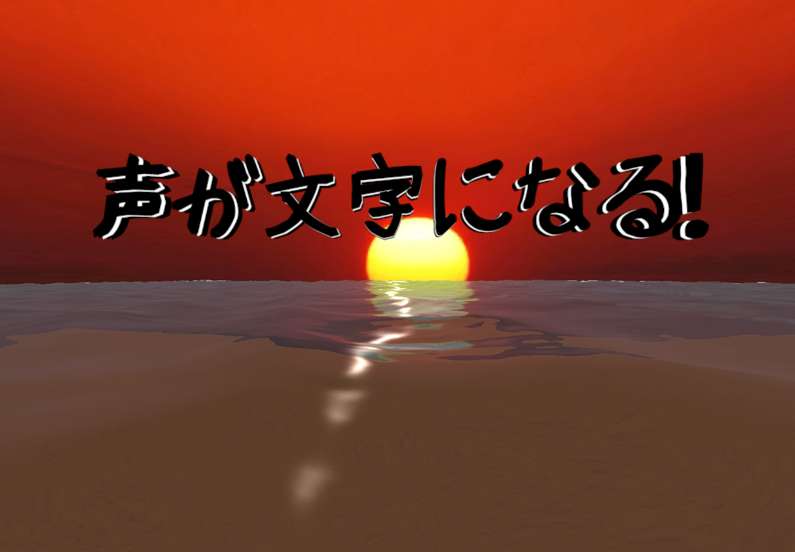
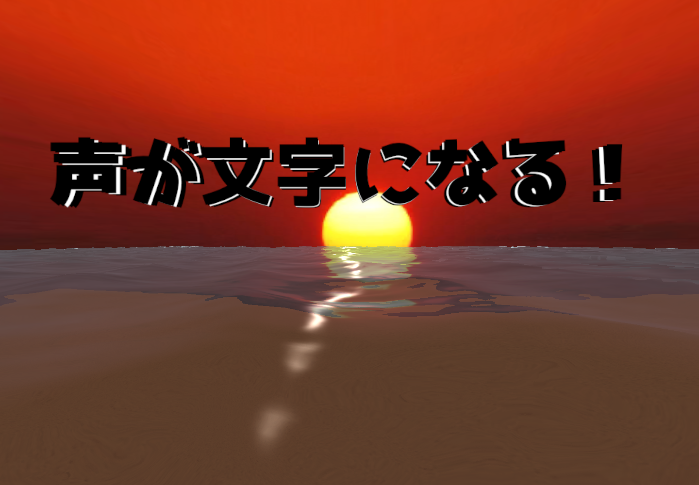
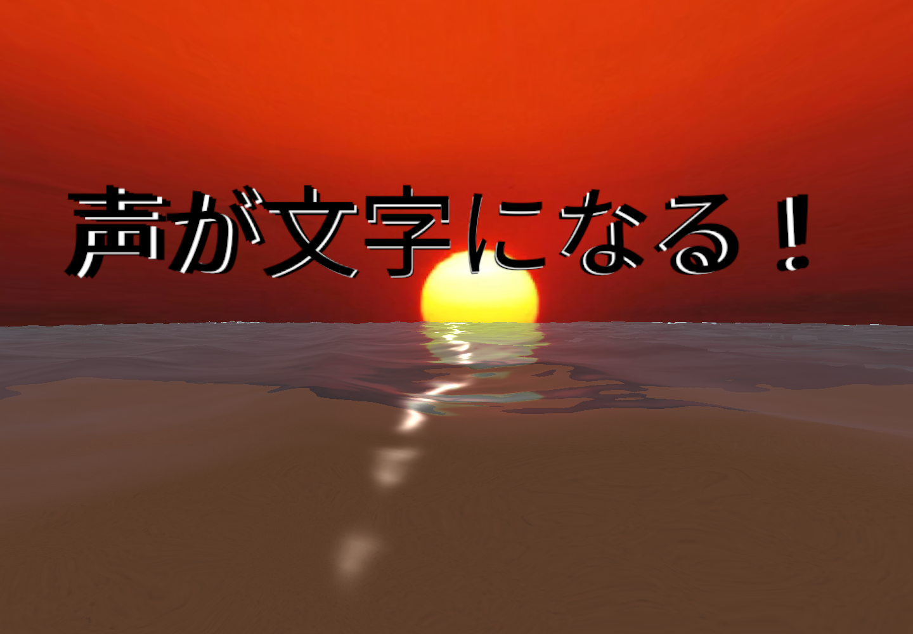

# 原作の文字とWater4の移植（0.7.0）

この作品は原作の移植・現代改修です。表現を別の仕組みで近似する前に、原作のデータ・処理を移植します。Quest対応やユーザーが選んだ変更は、その理由を区別して記録します。

## 文字

原作 `New Unity Project/Assets/Game/Prefabs/text.prefab` は、Unity 6.6にも存在する `TextMesh` を使っていました。0.6.0の5枚のTMPから、5枚のTextMeshへ戻しました。

- `offsetZ`: -0.5 / -0.25 / 0 / 0.25 / 0.5。親スケール(1,1,0.2)、各子スケール(0.1,0.1,1)。
- 文字サイズ1、フォントサイズ100、中央アンカー、左揃え、行間1、タブ4。
- 単独プレイは外層黒・中央白。通信時は外層白・中央赤、約1/3で全層赤。通信の色は送信側で決めて共有します。
- 元のフォント用GUI/Text Shaderと同じ非照明・両面・アルファ合成・深度書込なし・深度テストAlwaysをURP/XRへ移植。壁への衝突と壁による見え方の遮蔽は別で、Alwaysは原作の表示仕様です。
- 固定BoxCollider(1,1,1)、質量1、重力、初速(0,5,10)、寿命5秒。頭の前から視線方向への発射とオブジェクトプールは現代改修として維持。

### 書体の変更はユーザー指定

原作のHG創英角ポップ体は再配布許諾を確認できなかったため、新版への同梱を中止しました。2026-11-02のユーザー指定で **みかちゃんフォント**へ変更し、太字の **みかちゃん-PB** を初期選択にしています。「書体」ボタンで **みかちゃん-PB → ラノベPOP → Noto Sans JP** を循環し、選択を端末内に保存します。表示中の文字も切り替わります。書体は自分の表示設定で、受信した文字にも適用します。通信相手の設定は変更しません。書体が変わるため、字形・文字幅・黒白面の見え方まで原作同一とは扱いません。操作パネルは既存のNoto Sans CJK JPです。

作者サイトの現行ページは参照できなかったため、openSUSEが保存している作者の日本語利用条件 `dl.html` と配布物を使用しました。個人・商用利用と再配布を認め、フォント自体の販売（改変品を含む）を禁止する独自ライセンスです。OFLやMITへの再ライセンスはしていません。

- [原作者の利用条件の保存コピー](https://api.opensuse.org/public/source/M17N:fonts/mikachan-fonts/dl.html)
- [原配布物から作成された保存アーカイブ](https://api.opensuse.org/public/source/M17N:fonts/mikachan-fonts/mikachan-fonts.tar.bz2)
- アーカイブSHA-256: `a04545f3adfd4419405203144ea5acac3220b44d0bc929eb2ca24dea68b6b164`
- 採用TTFのSHA-256: `22ed9770a12a3b4ee9aa7f006161829d8e760b492bab59d9d4ca5b08a4d47af9`。バイナリ無改変。
- `QuestApp/Assets/Koekatamarin/ThirdParty/Mikachan-LICENSE.txt` に利用条件を保存し、APKの `assets/Notices/` にも同梱します。

原作保存領域・過去のGit履歴に存在するHGフォントの扱いは別途未解決です。今回、過去の履歴や原作のファイルは変更していません。

### ラノベPOPと追加方法

ラノベPOPは[作者の配布ページ](https://www.fontna.com/blog/lightnovel.html)で提供される2015年の旧版です。V2はBOOTHログインが必要なため、今回の同梱版とは区別します。同梱のM+ライセンスは商用・非商用の利用、改変、複製、再配布を認めます。作者のReadMeと著作権表示を `LightNovelPOP-LICENSE.txt` に保存してAPKにも含めます。配布ページには成果物の商標・意匠登録を避ける旨の付記があります。

- フォントSHA-256: `b52155b2b43581864bc1d10859b0ab2c5e6fca1f3581161a7bb3f18b36646363`
- 原ZIPのSHA-256: `4db9d2606c402588eae1f6608a747969d8c2eee933f5a7ea747fe7efa57ff57d`
- 書体にない文字用に、同梱Noto Sans CJK JPをフォールバック参照として設定。

書体の追加は `Experience.voiceFonts` の一覧で管理します。シーン再生成時には `ProjectSetup.Generate` の一覧へ安定したID・表示名・Font参照を追加し、利用条件をThirdPartyとStreamingAssetsのNoticesへ含めます。書体IDで保存するため、一覧の並べ替えで選択が変わりません。TextMeshの5層構造は書体追加で変えません。

## 海

実際の有効シーン `Game/test_taguchi.unity` のマテリアルを追跡すると、使用シェーダーは **FX/SimpleWater4 のHigh（LOD500）** でした。フル版のFX/Water4の泡処理は、このシェーダーにはありません。

`Water4Port.shader` と `Water4Reflection.cs` は、原作の `FX-SimpleWater4.shader`、`WaterInclude.cginc`、`PlanarReflection.cs` を元に移植しています。

- 4本のGerstner波の変位・法線、2つのスクロール法線、Fresnel、鏡面反射、深度による岸のブレンドを移植。
- 波・色・速度等の値は `Water4ExampleSimple.mat` から直接取得。
- 元の `smallWavesMap.png` と `ocean_plane.FBX` を無改変でコピー。元シーンの6枚のタイル位置・0.5倍スケールを結合メッシュで再現。旧 `unity_Scale.w` の値も計算へ反映。
- 反射カメラ・斜めクリップ面・画面の半解像度RTを移植。Questでは左右それぞれの視点を使う反射RTを用意。
- 旧GrabPassをURPのOpaque TextureとDepth Textureへ接続。元のGamma色計算をLinearプロジェクト内で明示的に扱う。
- 岸の深度ブレンドに関わる砂浜の位置・傾き・縮尺を原作に戻す。

### 一致と未検証の境界

数式・パラメーター・素材を移植したことは、旧Unity 4と画素単位で同一になることの証明ではありません。Unity世代間のフォントラスタライズ、GPUの精度、法線テクスチャの符号化が異なります。URPのOpaque Textureは先行する透明オブジェクトを含まず、旧GrabPassとの差があります。岸の最終アルファ合成もLinear空間です。

空の配置・砂のマテリアルは以前の再構成が残っており、シーン全体の忠実な移植は完了していません。Quest上の左右反射、フレーム時間、原作との見比べは実機確認が必要です。0.8.0では途中結果の差分発射へ復帰し、Silero VADを撤去しました。一括認識モデルによる途中結果の生成方法と原作との差は[音声処理の説明](offline-speech.ja.md)を参照してください。

## 検証

原作Prefabの数値、元の波テクスチャとマテリアル値、6タイルのメッシュ、反射行列、衝突等を自動テストします。EditorのVRプレビューは文字・海・反射RTを保存し、VRからMRへ戻したときに風景が消えることを確認します。PCの単眼描画をQuestのステレオ描画成功とは扱いません。

2026-11-02、0.7.0のQuest 3実機で、ユーザーが3書体すべての切替と文字表示を確認しました。海の左右反射と持続性能は引き続き未検証です。

### 描画の比較（PC Editor）

同じ位置・同じ5層構造のまま、書体だけを変更した比較です。

| みかちゃん-PB | ラノベPOP | Noto Sans JP |
| --- | --- | --- |
|  |  |  |
