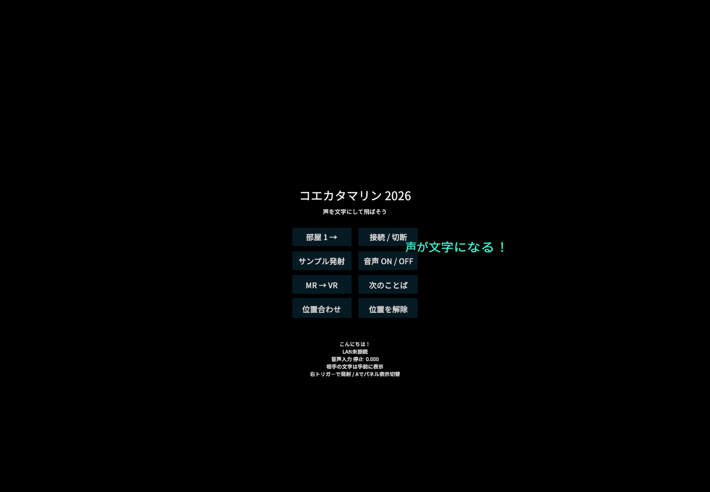

# Quest初期プロトタイプ

## 実装範囲

原作を保存したまま、`QuestApp/` に新規Unityプロジェクトを作成しました。

- Unity 6000.6.7f1 / Android ARM64 / IL2CPP / Vulkan / URP。
- Meta XR Core SDK 207.0.1、Unity OpenXR 1.19.0、Meta OpenXR 2.7.0。
- MRを標準にし、パススルー初期化を確認した後にMetaの境界表示抑制APIを要求します。OSの応答や設定によって抑制されない場合があります。
- VRに切り替える前に境界表示の復帰をOSから確認します。確認できない場合はMRを続けます。常時境界なしを宣言する `BOUNDARYLESS_APP` は使いません。
- 日本語テキストを飛ばすプール式表示。Noto Sans CJK JPを同梱し、リッチテキストは無効です。
- マイク権限要求、音量表示、端末内日本語音声認識。録音ファイル保存・音声のネット送信は行いません。
- SenseVoice Small INT8＋Silero VADで、発話の区切りに文字を発射します。モデルはAPK内に同梱します。[音声機能の詳細](offline-speech.ja.md)。
- VRでは原作の夕日・砂浜素材を表示し、海面をURPで再実装しています。原作と同じ速さを基準に文字を海へ飛ばします。キャラクターは未移植です。[VR復元の範囲](vr-restoration.ja.md)。

`6000.6.7f1` はUnity **6.6のパッチ7**です。Unity 6.7ではありません。2026-10-28の[Unity公式記事](https://unity.com/ja/blog/xreal-aura-games-made-with-unity)はAndroid XR向けに6.6を推奨し、6.7 LTSの正式リリース後の移行を案内しています。Quest向けには別途[Meta公式のUnity要件](https://developers.meta.com/vr/documentation/unity/unity-development-requirements/)も確認しています。

## 同じWi-Fi内のP2P

ホスト選出を必要としない対等なUDP通信です。各端末がUDP 47726で待ち受け、IPv4ブロードキャストで相手を発見します。1秒間隔のhelloと6秒のタイムアウト、部屋番号1〜9、最大8端末（自分を含む）を設定しています。

AndroidではLAN接続中のみWi-Fiの受信ロックを取得し、切断時・スリープ時に解放します。[Android MulticastLock API](https://developer.android.com/reference/android/net/wifi/WifiManager.MulticastLock)を利用していますが、実機やアクセスポイントの受信制限を解消できる保証はありません。

発射イベントには一意なIDを付け、相手ごとにACKを確認し、250ms間隔・最大6回の送信で再試行します。同じイベントの再送は重複表示しません。再送が尽きた回数は「未達」に表示します。通信の完全な到達保証や順序保証はありません。

部屋番号は認証機能ではありません。信頼できるLAN内での試験を想定し、暗号化・ユーザー認証は未実装です。ゲストWi-Fiの端末分離、ブロードキャスト制限、VPNなどがあると接続できません。外部サーバー、課金サービス、NAT越えはありません。

送信対象は確定テキスト、表示色、発射位置と水平な向きです。MRでは同じ現実の2点を指定して位置を合わせられます。どちらかが未設定の場合やVRでは、相手の文字を受信側の視点付近から発射します。[位置合わせの操作と制約](shared-space.ja.md)。共有アンカーや物理オブジェクトの状態同期はありません。端末をスリープすると切断し位置合わせも解除するので、復帰後は接続と位置合わせをやり直します。通信形式version 2のため、全端末を0.4.0へ更新してください。

## 操作

1. アプリ起動時はMRです。
2. 右コントローラーのポインターをボタンに合わせ、トリガーで選択します。
3. 「次のことば」でサンプルを選び、「サンプル発射」で文字を飛ばします。ボタン以外に向けたトリガーでも発射できます。
4. 複数端末では同じWi-Fiに接続し、同じ部屋番号で各端末の「接続 / 切断」を押します。
5. 「音声 ON / OFF」を押し、権限を許可します。モデル準備後に日本語で話すと、発話の区切りで文字を発射します。再度押すと停止します。初回はAPKからモデルを展開するため待ち時間があります。
6. Aボタンでパネルを隠せます。Bボタンで再表示して正面へ移動します。「MR → VR」で夕日の海岸へ切り替えます。
7. 同じ現実の場所で遊ぶ場合は「位置合わせ」を選び、共通の目印A・Bへ順に右コントローラーを置いて右グリップで指定します。AとBの水平距離は0.5〜5mです。全員が同じ向き・当て方で指定してください。

Unity EditorでのプレビューはSpaceで発射、Nで接続切替、Tabでパネル表示切替、Rでパネルを正面へ移動、マウスでボタン選択です。Editorの表示確認はQuest実機のMR・境界API確認を代替しません。

## ビルド

WindowsのPowerShellでリポジトリルートから実行します。既定のUnityインストール先と異なる場合は各コマンドに `-Editor '絶対パス/Unity.exe'` を指定します。

```powershell
python tools/setup_speech.py
./tools/unity.ps1 -Stage Import
./tools/unity.ps1 -Stage TextResources -WithoutEditorXr
./tools/unity.ps1 -Stage Setup -WithoutEditorXr
./tools/unity.ps1 -Stage Tests -WithoutEditorXr
./tools/unity.ps1 -Stage Android -WithoutEditorXr
./tools/inspect_apk.ps1
```

`Setup` は生成シーンと設定を再構成するため、手でシーンを編集した後は必要なときだけ実行します。出力先は `QuestApp/Builds/Koekatamarin2026.apk`、ログとテスト結果は `.work/` です。APKは開発用署名・Development Buildで、ストア公開用成果物ではありません。生成済みシーンは `QuestApp/Assets/Koekatamarin/Generated/Playground.unity` です。

このPCではMeta SDK 207.0.1のWindows用 `OVRPlugin.dll` がEditor起動時に異常終了する現象を確認しました。ヘッドセットなしのバッチ作業では、上記コマンドに **`-WithoutEditorXr`** を付けて回避します。パッケージ取得済みの `Library/PackageCache` 内でPC用DLLのEditor互換設定だけを一時的に無効にし、プロセス終了後に元へ戻します。Android用AAR・SDKのC#コードには手を加えません。このオプションを付けたプレビューではQuest Linkの動作確認はできません。

```powershell
./tools/unity.ps1 -Stage Android -WithoutEditorXr
```

実機を接続できるときは、開発者モードとUSBデバッグを許可して以下を実行します。

```powershell
adb install -r QuestApp/Builds/Koekatamarin2026.apk
```

## 検証と残作業

2026-11-01に音声認識、MR位置合わせと夕日のVRを含むDevelopment APK（0.4.0 / build 4）のビルドが成功しました。サイズは329,651,388 bytes（約330 MB）。`inspect_apk.ps1` で署名、ARM64のみであること、IL2CPP、Android用Meta XR・音声認識のネイティブライブラリ、マイク・LAN・パススルー・境界表示権限・VRカテゴリを検査済みです。3つのモデルファイルのハッシュとライセンスの同梱、`BOUNDARYLESS_APP` が含まれないことも確認しました。

SHA-256: `3106ed7f5882deccf00b273fd7f0f2c05e0a079b3048ad390bb82e4f4fd3c4c4`

EditModeテスト17件が成功しました。日本語の入力検証、不正な文字列・バージョン・部屋の拒否、イベントの重複排除、UTF-16の切り詰め、実UDPソケットによる相手発見・受信・ACK・重複発射の防止に加え、3種類の入力レートでの連続音声変換、日本語WAVの実認識、VRの素材参照・起動時非表示・頭の位置を動かさない切替を確認しています。加えて、手動位置合わせの座標変換・不正な測定値の拒否・発射位置と向きのUDP送受信・集中到着した複数イベントの受信を確認しました。Windows上の試験であり、Quest間の通信や実機ASRの確認ではありません。

`PreviewVR` で夕日の風景を描画し、MRへ戻したときにVR風景が消えてカメラ背景が透過へ戻ることも確認しました。Editorの境界応答は模擬であり、実機APIの検証ではありません。

現在Quest 3を接続できないため、装着しての起動、パススルー、境界復帰、コントローラー、AndroidでのLAN発見・マイク、描画速度は未確認です。

Editorで日本語UIと文字の描画を目視確認しました。下はPC用XRプラグインを無効にした表示確認用の画像です。このプレビューではOVRManager初期化時に `DllNotFoundException` が記録されるため、XR初期化や実機動作の成功を示すものではありません。APK内にAndroid用 `libOVRPlugin.so` が存在することは別途検査しています。



残る主な作業は、複数端末の位置合わせ精度の実測、遊び方の改善と実機調整です。原作のキャラクターは未移植です。音声機能は実装済みですが、実機で日本語精度、発話終了から表示までの遅延、発熱、メモリを確認して調整します。

## 同梱フォント

Noto Sans CJK JPはSIL Open Font License 1.1です。ライセンスは `QuestApp/Assets/Koekatamarin/ThirdParty/NotoSans-LICENSE.txt` に同梱しています。原作の旧フォント・旧SDKバイナリは新アプリへコピーしていません。
