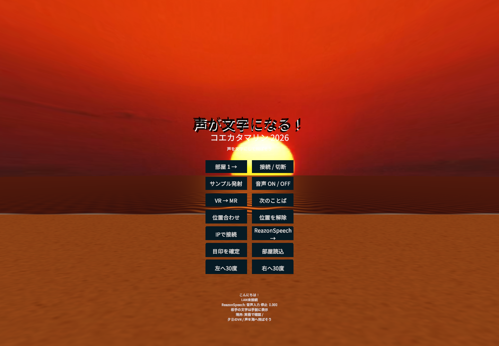

> 最新版は0.11.0。最低音量の変更・保存と入力ゲージを追加。56件のUnityテスト・Editor描画・APK検査を通過し、Quest 3へ導入・起動済みです。ユーザーがゲージの動作と閾値調整による不要な発射の減少を実機確認しました。[音量の操作](offline-speech.ja.md)・[検査結果](validation/quest-0.11.0.json)。0.10.0のライブ空間線と文字の衝突はユーザーが装着確認済み。[導入記録](device-validation.ja.md)・[空間の操作](mr-collision-settings.ja.md)。以下は以前の版の記録を含みます。

> 0.7.0更新: 原作の5層TextMeshとWater4を移植し、みかちゃん-PB・ラノベPOP・Noto Sans JPの切替を追加しています。[現在の表現と変更範囲](legacy-appearance-port.ja.md)を参照してください。以下は0.6.0以前の記録を含みます。

# Questプロトタイプ

## 実装範囲

原作を保存したまま、`QuestApp/` に新規Unityプロジェクトを作成しました。

- Unity 6000.6.7f1 / Android ARM64 / IL2CPP / Vulkan / URP。
- Meta XR Core SDK 207.0.1、MR Utility Kit 207.0.0、Unity OpenXR 1.19.0、Meta OpenXR 2.7.0。
- MRを標準にし、パススルー初期化を確認した後にMetaの境界表示抑制APIを要求します。OSの応答や設定によって抑制されない場合があります。
- スリープ復帰後も初期化を最大10秒待ちます。VR切替・再スリープで以前の待機を取り消し、遅れた初期化がVR中に境界を抑制しないようにしています。パネルに準備中・待ち時間超過・実機の境界状態を表示します。
- VRに切り替える前に境界表示の復帰をOSから確認します。確認できない場合はMRを続けます。常時境界なしを宣言する `BOUNDARYLESS_APP` は使いません。
- 日本語テキストを飛ばすプール式表示。Noto Sans CJK JPを同梱し、リッチテキストは無効です。
- マイク権限要求、音量表示、端末内日本語音声認識。録音ファイル保存・音声のネット送信は行いません。
- ReazonSpeech k2-v2とSenseVoice Smallを切り替え、共通のSilero VADによる発話の区切りに文字を発射します。起動時はReazonSpeech・音声ONです。モデルはAPK内に同梱します。[0.6.0の操作](modern-controls.ja.md)。
- 右手のピンチでパネル操作、左手のピンチ移動または左スティックでVR内を移動できます。文字は頭の前から5層構造で発射し、重力と衝突を使います。MRでは部屋データの許可後、保存されたメッシュまたは壁・床・家具の形状を読み込みます。
- VRでは原作の夕日・砂浜素材を表示し、海面をURPで再実装しています。原作と同じ速さを基準に文字を海へ飛ばします。キャラクターは未移植です。[VR復元の範囲](vr-restoration.ja.md)。

`6000.6.7f1` はUnity **6.6のパッチ7**です。Unity 6.7ではありません。2026-10-28の[Unity公式記事](https://unity.com/ja/blog/xreal-aura-games-made-with-unity)はAndroid XR向けに6.6を推奨し、6.7 LTSの正式リリース後の移行を案内しています。Quest向けには別途[Meta公式のUnity要件](https://developers.meta.com/vr/documentation/unity/unity-development-requirements/)も確認しています。

## 同じWi-Fi内のP2P

ホスト選出を必要としない対等なUDP通信です。各端末がUDP 47726で待ち受け、IPv4ブロードキャストで相手を発見します。1秒間隔のhelloと6秒のタイムアウト、部屋番号1〜9、最大8端末（自分を含む）を設定しています。

AndroidではLAN接続中のみWi-Fiの受信ロックを取得し、切断時・スリープ時に解放します。[Android MulticastLock API](https://developer.android.com/reference/android/net/wifi/WifiManager.MulticastLock)を利用していますが、実機やアクセスポイントの受信制限を解消できる保証はありません。

発射イベントには一意なIDを付け、相手ごとにACKを確認し、250ms間隔・最大6回の送信で再試行します。同じイベントの再送は重複表示しません。再送が尽きた回数は「未達」に表示します。通信の完全な到達保証や順序保証はありません。

自動発見できない場合は「IPで接続」から相手のIPv4を指定できます。相手の応答後は双方が直接helloを送って接続を維持します。[IP指定の操作と制約](lan-manual.ja.md)。

部屋番号は認証機能ではありません。信頼できるLAN内での試験を想定し、暗号化・ユーザー認証は未実装です。ゲストWi-Fiの端末分離、ブロードキャスト制限、VPNなどがあると接続できません。外部サーバー、課金サービス、NAT越えはありません。

送信対象は確定テキスト、表示色、発射位置と水平な向きです。MRでは同じ現実の2点を指定して位置を合わせられます。どちらかが未設定の場合やVRでは、相手の文字を受信側の視点付近から発射します。[位置合わせの操作と制約](shared-space.ja.md)。共有アンカーや物理オブジェクトの状態同期はありません。端末をスリープすると切断し位置合わせも解除するので、復帰後は接続と位置合わせをやり直します。通信形式は0.4.0と同じversion 2で、0.3.0以前とは接続できません。実機試験は全端末を同じ最新版に揃えて行ってください。

## 操作

1. アプリ起動時はMRです。
2. 右コントローラーのポインター＋トリガー、または右手のポインター＋人差し指ピンチで選択します。
3. 「次のことば」でサンプルを選び、「サンプル発射」で文字を飛ばします。ボタン以外に向けたトリガーでも発射できます。
4. 複数端末では同じWi-Fiに接続し、同じ部屋番号で各端末の「接続 / 切断」を押します。
5. 音声は自動でONになります。初回はマイク権限を許可します。モデル準備後に日本語で話すと、発話の区切りで文字を発射します。「音声 ON / OFF」で停止・再開、モデル名ボタンで認識器を切り替えます。初回はAPKからモデルを展開するため待ち時間があります。
6. Aボタンでパネルを隠せます。Bボタンで再表示して正面へ移動します。「MR → VR」で夕日の海岸へ切り替えます。
7. 同じ現実の場所で遊ぶ場合は「位置合わせ」を選び、共通の目印A・Bへ順に右コントローラーを置いて右グリップで指定します。AとBの水平距離は0.5〜5mです。全員が同じ向き・当て方で指定してください。
8. 空間データの許可後にMRの部屋形状を読み込みます。未設定ならQuestの空間設定を行い、「部屋読込」で再試行できます。VRの移動・手操作の詳細は[0.6.0の操作](modern-controls.ja.md)を参照してください。

Unity EditorでのプレビューはSpaceで発射、Nで接続切替、Tabでパネル表示切替、Rでパネルを正面へ移動、マウスでボタン選択です。Editorの表示確認はQuest実機のMR・境界API確認を代替しません。

## ビルド

WindowsのPowerShellでリポジトリルートから実行します。既定のUnityインストール先と異なる場合は各コマンドに `-Editor '絶対パス/Unity.exe'` を指定します。

```powershell
python tools/setup_speech.py
./tools/unity.ps1 -Stage Import
./tools/unity.ps1 -Stage TextResources -WithoutEditorXr
./tools/unity.ps1 -Stage Setup -WithoutEditorXr
./tools/unity.ps1 -Stage Tests -WithoutEditorXr
./tools/unity.ps1 -Stage Android -WithoutEditorXr
./tools/inspect_apk.ps1
python tools/inspect_native_speech.py
```

`Setup` は生成シーンと設定を再構成するため、手でシーンを編集した後は必要なときだけ実行します。出力先は `QuestApp/Builds/Koekatamarin2026.apk`、ログとテスト結果は `.work/` です。APKは開発用署名・Development Buildで、ストア公開用成果物ではありません。生成済みシーンは `QuestApp/Assets/Koekatamarin/Generated/Playground.unity` です。

このPCではMeta SDK 207.0.1のWindows用 `OVRPlugin.dll` がEditor起動時に異常終了する現象を確認しました。ヘッドセットなしのバッチ作業では、上記コマンドに **`-WithoutEditorXr`** を付けて回避します。パッケージ取得済みの `Library/PackageCache` 内でPC用DLLのEditor互換設定だけを一時的に無効にし、プロセス終了後に元へ戻します。Android用AAR・SDKのC#コードには手を加えません。このオプションを付けたプレビューではQuest Linkの動作確認はできません。

```powershell
./tools/unity.ps1 -Stage Android -WithoutEditorXr
```

実機を接続できるときは、開発者モードとUSBデバッグを許可して以下を実行します。

```powershell
adb install -r QuestApp/Builds/Koekatamarin2026.apk
```

端末の選択、APK検査付きの導入、起動、診断ログ保存をまとめた `tools/quest_device.py` も利用できます。[実機導入・検証手順](device-validation.ja.md)を参照してください。

## 検証と残作業

2026-11-02にDevelopment APK（0.6.0 / build 6）のビルドが成功しました。サイズは505,965,324 bytes（約506 MB）。署名、ARM64/IL2CPP、Meta XR・MRUK・音声認識ライブラリ、マイク・LAN・手・空間データ・境界表示権限を検査しました。音声モデル7ファイルのハッシュとライセンスも確認済みです。常時境界なしの `BOUNDARYLESS_APP` は含みません。

SHA-256: `acbad92c56aa72dfcf4862a5307d4680a4fb3a6876466ea5d822bea3fa055ddf`

Unity EditModeテスト40件が成功しました。従来の入力検証、実UDPによるP2P通信、位置合わせ、音声変換、MR切替の試験に加え、両モデルの日本語WAV認識、頭の前からの発射、VR移動・回転と原点復帰、5層の文字が実際のMeshColliderで止まる物理シミュレーションを確認しています。Windows上の試験です。音声用ネイティブライブラリ2本のARM64 ELF・依存名・C#呼出先25関数も検査しました。

`PreviewVR` で5層の文字と夕日の風景を描画し、VR→MRの往復を確認しました。PCプレビューでは端末専用のMRUKと手プレハブを保存前のシーンから一時的に除外し、境界応答を模擬します。Questの手追跡・部屋データ・境界APIの動作確認を代替しません。



0.5.0ではQuest 3への導入・起動が成功し、ユーザーがパネル表示と発話からの文字表示を確認しました。新しい0.6.0の実機記録は[導入・検証記録](device-validation.ja.md)、静的検査は[APK記録](validation/quest-0.6.0.json)と[ネイティブ検査](validation/quest-0.6.0-native-speech.json)を参照してください。

残る確認は実機での認識精度・遅延・持続性能、手操作とVR移動、部屋への衝突、スリープ復帰、2台通信・位置合わせです。原作のキャラクターは未移植です。海は原作Water4そのものではなく、新しいURPシェーダーです。[原作との対応](original-voice-and-water.ja.md)。
