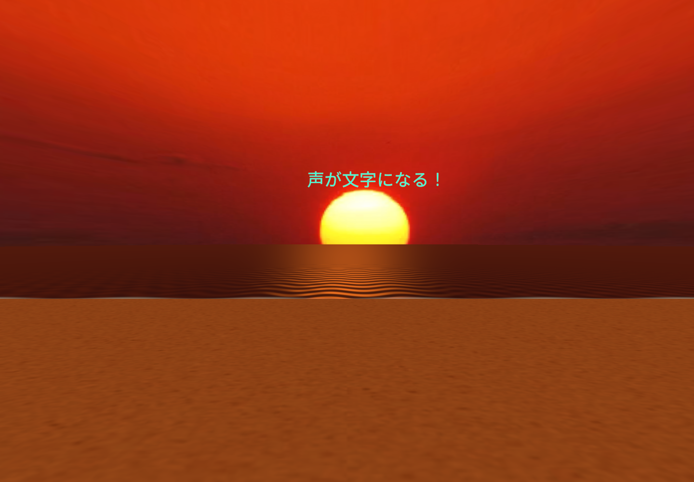

> 0.7.0更新: 原作の5層TextMeshとWater4を移植し、みかちゃん-PB・ラノベPOP・Noto Sans JPの切替を追加しています。[現在の表現と変更範囲](legacy-appearance-port.ja.md)を参照してください。以下は0.6.0以前の記録を含みます。

> 2026-11-02更新: 0.6.0ではVR移動・手入力・5層文字・Rigidbody衝突を追加しています。[現在の操作](modern-controls.ja.md)と[原作構造の再調査](original-voice-and-water.ja.md)を参照してください。以下の発射・操作の説明は0.3〜0.5時点の記録です。水面は新規URP実装で、原作Water4そのものではありません。

# 夕日のVRモード

原作の夕日画像・空のFBX・砂浜テクスチャを使い、Quest用のVR背景を復元しました。標準モードは引き続きMRです。旧Unity 4のシーン全体や旧SDKを読み込む方式ではなく、残っている素材を新しいURPシーンへ移しています。

## 復元したもの

- 原作 `Yuuhi.FBX` と `Yuuyake.tga` による夕空。画像とFBXの内容は変更せず、現代のImporterとURP Unlitマテリアルで表示。
- 原作 `Sand_Pattern.jpg` による砂浜。
- 海面、夕日の反射、岸付近の薄い波。旧Water4の依存欠損と旧シェーダーを避け、新規のURPシェーダーで再実装。
- VRでの文字の射出は原作 `shoot.cs` / `multiShoot.cs` の前方10 m/s、上方5 m/s、重力を基準にした軌道。視認性のためMRより大きく表示。

水面は9,600三角形のメッシュと1パスの不透明シェーダーです。反射カメラ、画面コピー、深度テクスチャは使用しません。遠くの波は画素サイズに応じて弱めます。全体のQuest実機性能は未測定です。

原作のキャラクター、プレイヤーアバター、全物理挙動の再現は未実装です。文字は上限64個のプールで管理し、5秒で消します。地面相当の高さで軽く跳ねますが、海面の物理シミュレーションやオブジェクト同士の衝突同期はありません。

## 切替と操作

「MR → VR」を押すと、境界表示の抑制解除を要求し、OSの `NotSuppressed` 応答を確認した後にパススルーを無効化して夕日の風景を表示します。確認できなければMRを維持します。`BOUNDARYLESS_APP` 宣言は使いません。

「VR → MR」では風景を非表示にしてパススルーへ戻し、初期化を確認してから境界表示抑制を要求します。起動時も風景は非表示であり、MRの実景を塞ぎません。

- Aボタン：操作パネルとポインターの表示切替。音声認識と文字の発射は継続。
- Bボタン：操作パネルを再表示して正面へ移動。
- 右トリガー：ボタン操作、またはサンプル文の発射。
- 「音声 ON / OFF」：端末内の日本語音声認識。

EditorではTabがA相当、RがB相当です。VRの砂浜は入場時の頭の向きを正面とし、頭の高さから1.65 m下に配置します。実際の床高を検出する機能ではなく、座位・身長によって違和感が出る可能性があるため、実機調整が残っています。移動用スティック操作はありません。

## 素材の由来

コピー先は `QuestApp/Assets/Koekatamarin/Art/Legacy/` です。[元ファイルとコピーのSHA-256](legacy-art-provenance.json)を記録しています。原作ファイルはそのまま保存し、新版コピーには新しいUnity GUIDを割り当てています。

FBXはWindowsチェックアウト時のCRLFを保持しています。元のGit blobのLFとの差は改行だけであり、両方のハッシュを記録しています。画像2枚は元のGit blobともバイト単位で一致します。

これらは原作プロジェクトに含まれる作品素材として使用し、新たにMIT等のライセンスは付けません。元履歴の作者情報を保持します。旧フォント、Photon、Oculus DK1用バイナリ、旧Water4コードは新APKへコピーしていません。

## 確認範囲

生成シーンの素材参照、MR起動時の風景非表示、表示切替で頭の位置を動かさないこと、実行時マテリアルの再利用を自動検査します。

`./tools/unity.ps1 -Stage PreviewVR -WithoutEditorXr` はVR描画を保存し、MRへ戻したときにVRオブジェクトが消え、背景のアルファが0へ戻ることを確認します。PC用OVRPluginを無効にしたプレビューでは境界応答を模擬します。これはQuestの境界API・ステレオ描画・パススルーの成功を示すテストではありません。

